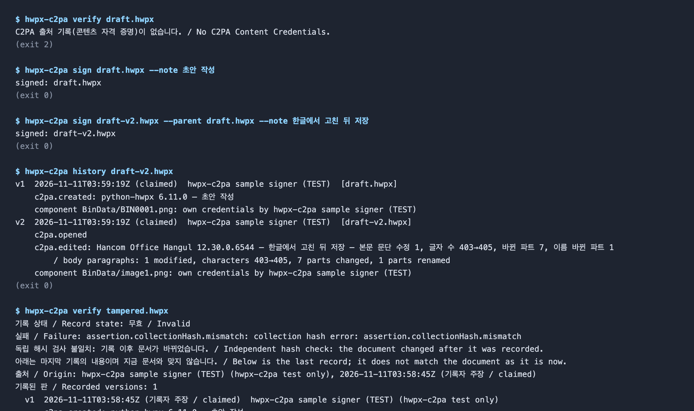
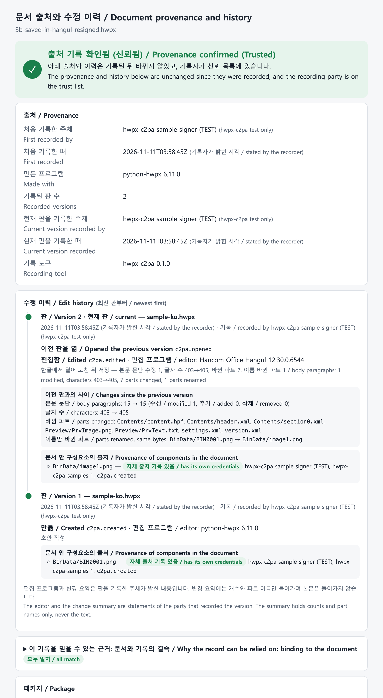
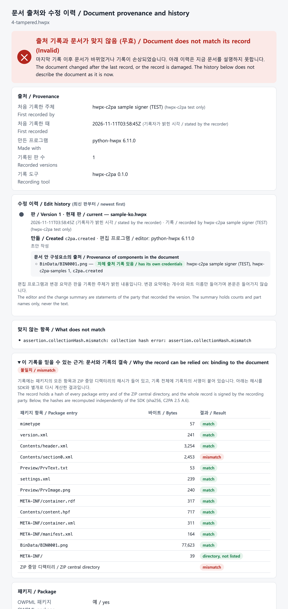
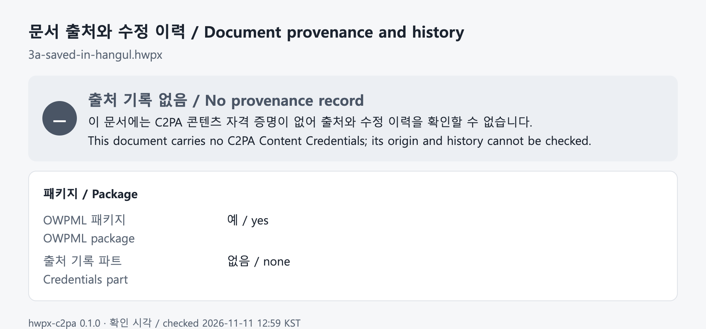
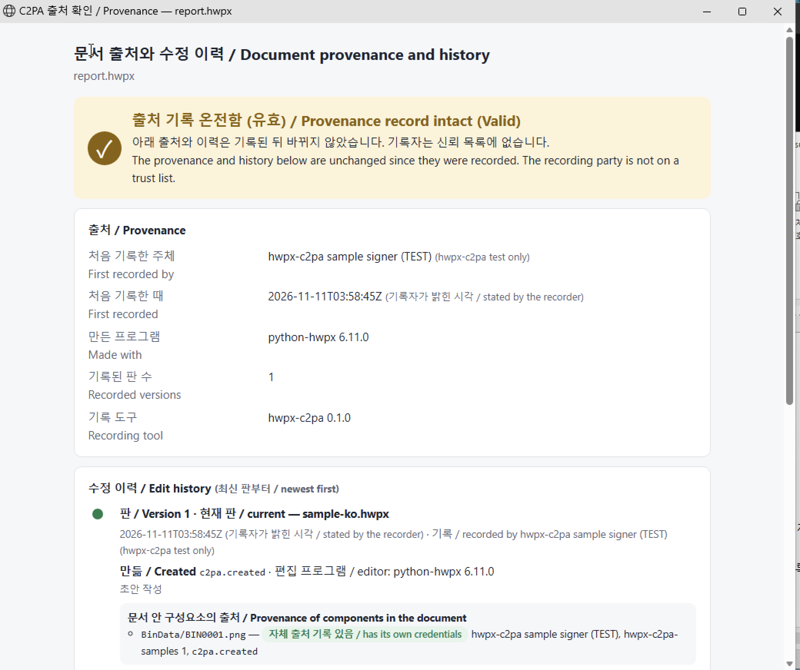
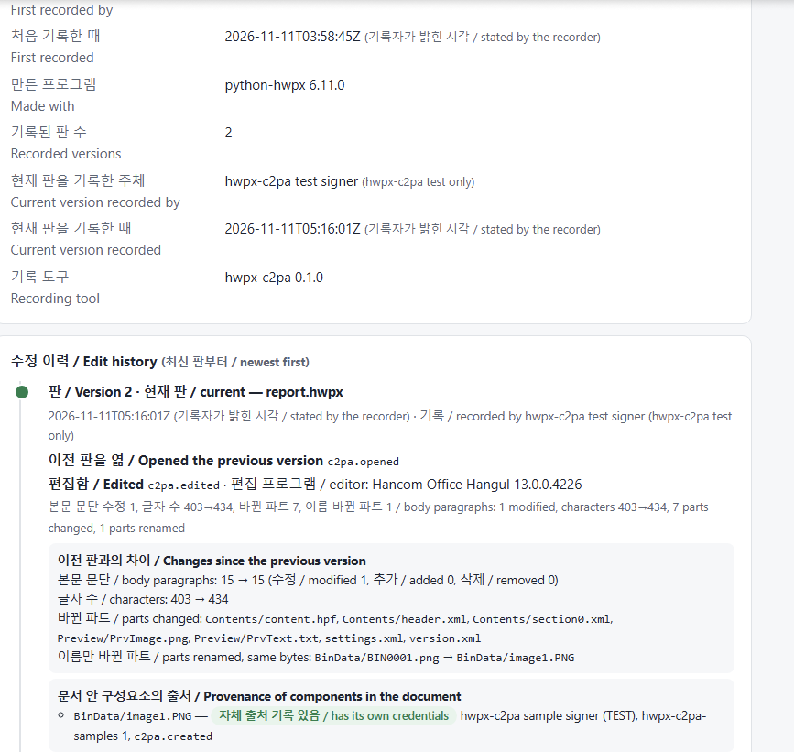
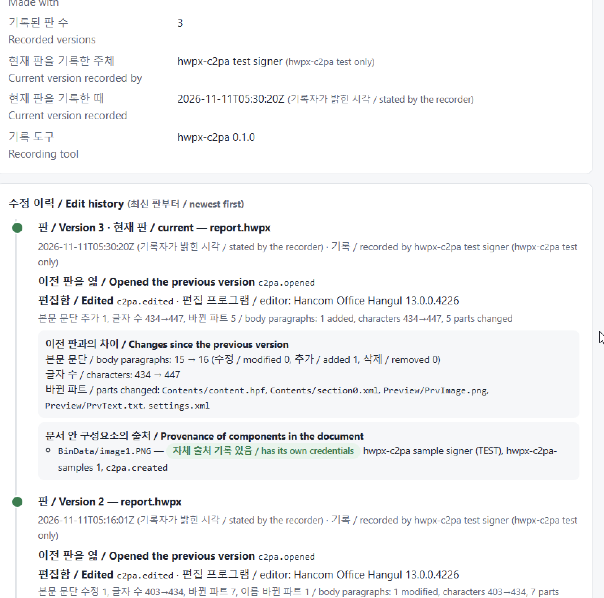

# hwpx-c2pa

[English](README.md) | **한국어**

**HWPX(아래한글, OWPML · KS X 6101) 문서의 출처와 수정 이력을 C2PA 콘텐츠 자격 증명으로 기록하고 확인하는 엔진과 한글 애드온**

개발: Dongsun Nam (speeno) · 라이선스: MIT · 상태: 알파 (0.1.0)

## 이 프로젝트에 대하여

- **목적.** C2PA는 주로 이미지, 영상 같은 멀티미디어 콘텐츠에 쓰인다. 이 프로젝트는 그 밖의 다양한 디지털 생성 객체 가운데 텍스트 문서(Textual Document) 형식인 OWPML(HWPX)에도 C2PA를 적용할 수 있음을 확인하고, 활용 가능성을 보기 위해 개발했다.
- **결과.** 적용할 수 있다. C2PA 기술 규격 2.5 부속서 A.6에 따라 OWPML 스키마를 바꾸지 않고 HWPX 패키지에 콘텐츠 자격 증명을 넣고 읽을 수 있으며, 문서가 출처와 수정 이력을 판에서 판으로 이어 갈 수 있다.
- **아래한글 소프트웨어에서 확인된 점.** 애드온 없이 동작하려면 아래한글의 구현 로직 몇 곳을 고쳐야 한다. 첫째는 문서를 저장할 때 자격 증명이 지워지는 것이다. [문제점과 개선점](docs/hangul-c2pa-support.ko.md) 참조(제품 항목 I1~I12).
- **OWPML 규격에서 확인된 점.** OWPML 규격(KS X 6101)에도 개정이 필요한 부분이 있다. 처리기가 모르는 파트를 어떻게 다루는지, 자격 증명 파트를 어떻게 선언하는지 등이다. 같은 문서 참조(표준 항목 S1~S5).
- **활용 형태.** 이 프로젝트는 **아래한글 애드온**과 **명령줄(CLI) 도구** 두 가지 형태로 쓸 수 있게 개발했다.

- 동작 원리(블록 다이어그램): [docs/how-it-works.ko.md](docs/how-it-works.ko.md)
- 적용 사례와 화면: [docs/case-study.ko.md](docs/case-study.ko.md)
- 한국어·영어 샘플: [samples/](samples/README.ko.md)
- 한글의 C2PA 지원 문제점과 개선점: [docs/hangul-c2pa-support.ko.md](docs/hangul-c2pa-support.ko.md)

## 미리 보기

**1. 판 기록과 이력 확인** (`sign`, `history`): 판 1을 만들고, 한글에서 고친 판 2를 기록한 뒤 무엇이 바뀌었는지 본다.



**2. 문서의 출처와 수정 이력** (`view`): 판마다 누가, 언제, 어떤 프로그램으로 기록했는지, 이전 판에서 무엇이 바뀌었는지, 문서 안 그림이 어디서 왔는지를 보여 준다.



**3. 기록 없이 바뀐 문서**: 이력이 지금 문서를 설명하지 못한다고 알리고, 달라진 파트를 표시한다.



**4. 애드온 없이 한글에서 저장한 문서**: 기록이 사라진다.



**5. Windows용 한글 2024에서 애드온으로**: "C2PA 출처" 버튼을 누르면 열려 있는 문서의 출처 창이 뜬다.



**6. 한글에서 Ctrl+S를 누른 뒤**: 저장이 열려 있는 그 문서에 판 2로 기록된다. 편집 프로그램(Hancom Office Hangul 13.0.0.4226)과 바뀐 내용이 함께 남는다.



**7. 다시 고치고 일반 저장 버튼을 누른 뒤**: 판 2에 이어 판 3이 기록된다.



## 한글 애드온 설치

### Windows: 한글 안의 추가 기능

Windows 11의 한글 2024(13.0.0.4226, 32비트)에서 시험했다. 이 저장소(클론 또는 ZIP)가 필요하다. 관리자 권한은 필요 없다.

```powershell
powershell -ExecutionPolicy Bypass -File addon\windows\install.ps1 -Dll 경로\HwpxC2paAddon.dll
```

스크립트가 하는 일: Python 3.12 설치(없을 때만), 전용 환경에 엔진 설치, C2PA 라이브러리 받기, 시험용 인증서와 설정 만들기, `Hwp.exe`가 32비트인지 64비트인지 확인해 맞는 애드온 DLL 선택, 현재 사용자에게 등록(`HKCU\Software\Hnc\HwpUserAction\Modules`), 샘플을 `문서\hwpx-c2pa-samples`에 복사, 바탕 화면에 **Hangul C2PA** 바로 가기 만들기. DLL은 CI가 빌드한다(`test` 워크플로의 `HwpxC2paAddon-Win32`, `HwpxC2paAddon-x64` 아티팩트). `-Dll`을 주지 않으면 최신 릴리스에서 받는다.

**한글은 "Hangul C2PA" 바로 가기로 시작한다**(또는 `hwpx-c2pa hangul [파일]`). 한글은 이런 종류의 애드온을 오토메이션으로 요청받을 때만 불러온다. 그래서 평소처럼 시작한 한글에는 애드온이 보이지 않는다.

한글 안에서 애드온이 하는 일:

| 한글에서 | 일어나는 일 |
|---|---|
| **C2PA 출처** 버튼 | 출처 창을 연다: 출처, 판별 수정 이력, 그림의 출처, 해시 대조 |
| **저장**(Ctrl+S, 저장 버튼, 파일 메뉴)과 **C2PA 저장** 버튼 | 저장한 뒤, 열려 있는 그 문서에 저장한 판을 기록한다: 편집 프로그램, 변경 요약, 이전 판 연결 |
| **다른 이름으로 저장** | 한글의 대화상자를 그대로 띄운 뒤, 새 파일을 기록하고 이전 파일을 이전 판으로 잇는다 |
| HWPX가 아닌 문서 | 평소대로 저장하고 기록하지 않는다 |

- 저장은 `ReplaceAction`으로 가로챈다. 한글의 원래 저장을 그대로 두려면 `HKCU\Software\hwpx-c2pa\ReplaceSave`(DWORD)를 0으로 두고 버튼을 쓴다.
- 한글은 열려 있는 문서의 파일을 잠근다. 애드온은 먼저 임시 사본으로 저장해 잠금을 풀고, 기록이 든 파일을 문서 자리에 넣는다.
- 문서마다 마지막으로 기록한 판을 `%LOCALAPPDATA%\hwpx-c2pa\parents`에 보관한다. 애드온을 거치지 않은 저장으로 한글이 기록을 지워도, 다음 기록 때 그 보관본에 이어 붙인다.
- 아직 시험하지 않은 것: 이 저장소의 `install.ps1` 전체(각 단계는 시험기에서 이전 형태로 실행했다), 64비트 한글, 한글 2020과 2022, "다른 이름으로 저장". 제거: `addon\windows\useraction\register.ps1 -Remove`.

### macOS 또는 애드온 없이: 폴더 감시

Mac용 한글에는 애드인 인터페이스가 없다. 폴더 감시가 그 폴더에 저장되는 `.hwpx`를 매번 새 판으로 기록한다.

```bash
pip install "hwpx-c2pa[devcerts] @ git+https://github.com/speeno/hwpx-c2pa" && hwpx-c2pa fetch-lib
hwpx-c2pa watch ~/Documents/Recorded --cert certs/signer-chain.pem --key certs/signer.key
```

## 무엇을 하나

C2PA는 전자서명 기능이 아니라 **출처(provenance) 기록**이다. 문서가 어디서 왔고, 판마다 누가 어떤 프로그램으로 무엇을 했는지를 문서 안에 넣어 함께 다니게 한다. 서명과 해시는 그 기록이 나중에 바뀌지 않았음을 보이는 수단이다.

이 도구가 판마다 기록하는 것:

- **누가, 언제**: 기록 주체(인증서)와 시각(타임스탬프, 없으면 기록자가 밝힌 시각).
- **무엇으로**: 문서를 만들거나 고친 프로그램(패키지의 `version.xml`에 적힌 이름과 버전).
- **무엇을 했는가**: 만듦(`c2pa.created`), 이전 판을 열어 편집함(`c2pa.opened`, `c2pa.edited`), 기록자가 적은 메모(`--note`).
- **무엇이 바뀌었는가**: 이전 판과 비교한 변경 요약(본문 문단 수정·추가·삭제 수, 글자 수, 바뀐 파트). 개수와 파트 이름만 넣고 본문은 넣지 않는다.
- **어느 판에서 나왔는가**: 이전 판의 기록을 `parentOf`로 이어, 마지막 파일 하나로 전체 이력을 볼 수 있다.
- **안에 든 그림의 출처**: 그림이 자체 C2PA 기록(카메라, 그림 도구, 생성형 AI 등)을 가지고 있으면 `componentOf`로 연결한다.

확인할 때는 `history`와 `view`가 이 이력을 판별로 보여 주고, 기록 이후 문서가 바뀌었으면 어느 파트가 달라졌는지 알려 준다.

기술 바탕: C2PA 기술 규격 2.5 부속서 A.6(ZIP 기반 형식). 기록은 `META-INF/content_credential.c2pa` 파트 하나로 들어가며 OWPML 스키마는 바꾸지 않는다. 기록 작성과 서명은 공식 C2PA SDK(c2pa-rs, c2pa-python)가 하고, 해시는 SDK와 별개로 다시 계산해 대조한다(`check`). 한글은 저장할 때 이 파트를 지우므로, 애드온이 저장할 때마다 새 판을 기록한다. 자세한 구조는 [docs/how-it-works.ko.md](docs/how-it-works.ko.md).

## 설치

```bash
pip install git+https://github.com/speeno/hwpx-c2pa
hwpx-c2pa fetch-lib     # HWPX를 처리할 수 있는 C2PA 라이브러리(0.91.11)를 받는다
hwpx-c2pa info          # "supported: True"인지 확인
```

`fetch-lib`가 필요한 이유: c2pa-python 0.38.2에 들어 있는 라이브러리(0.91.6)는 Deflate로 압축된 ZIP 항목을 처리하지 못한다. HWPX는 모두 Deflate를 쓴다. `fetch-lib`는 c2pa-rs 공식 릴리스에서 라이브러리를 받고 SHA-256을 확인한 뒤 사용자 캐시에 둔다.

## 사용

```bash
# 시험용 인증서 만들기 (실제 문서에는 쓰지 말 것)
pip install "hwpx-c2pa[devcerts] @ git+https://github.com/speeno/hwpx-c2pa"
hwpx-c2pa dev-certs ./certs

# 첫 판 기록 (sign과 record는 같은 명령)
hwpx-c2pa sign 문서.hwpx --note "초안 작성" --cert certs/signer-chain.pem --key certs/signer.key
# 고친 판 기록: 이전 판을 잇고 변경 요약을 남긴다
hwpx-c2pa sign 새판.hwpx --parent 이전판.hwpx --note "3장 예산 수정" ...
hwpx-c2pa history 새판.hwpx               # 출처와 판별 수정 이력
hwpx-c2pa view 새판.hwpx --trust certs/root-ca.pem   # 출처와 이력 창(브라우저)
hwpx-c2pa verify 새판.hwpx --trust certs/root-ca.pem # 요약과 종료 코드
hwpx-c2pa check 새판.hwpx                 # SDK 없이 해시 재계산
hwpx-c2pa watch ~/Documents/Signed        # 폴더 감시: 저장할 때마다 새 판 기록
```

- `verify` 종료 코드: 0 온전함, 1 무효(변조), 2 자격 증명 없음, 3 오류.
- 상태: `Trusted`(기록이 온전하고 기록 주체가 신뢰 목록에 있음), `Valid`(기록은 온전하나 기록 주체가 신뢰 목록에 없음), `Invalid`(기록 이후 문서가 바뀌었거나 기록이 손상됨).
- 편집 프로그램과 변경 요약은 기록 주체가 밝힌 내용이다. 한글이 직접 기록한 것이 아니다([docs/how-it-works.ko.md](docs/how-it-works.ko.md) 5절).
- 인증서와 키를 매번 주지 않으려면 설정 파일을 쓴다(`hwpx-c2pa info`가 위치를 알려 준다).

```json
{"cert": "/path/signer-chain.pem", "key": "/path/signer.key", "tsa": "http://timestamp.example", "trust": "/path/anchors.pem"}
```

Python에서:

```python
from hwpx_c2pa import load_signer, sign, verify
signer = load_signer("signer-chain.pem", "signer.key")
v1 = sign(open("문서.hwpx", "rb").read(), signer, title="문서.hwpx", note="초안 작성")
v2 = sign(open("고친문서.hwpx", "rb").read(), signer, title="문서.hwpx", parent=v1, note="예산 수정")
for step in verify(v2).history:      # 최신 판부터
    print(step["version"], step["time"], step["recorded_by"], step["actions"], step["changes"])
```

## 한글 애드온

| 애드온 | 플랫폼 | 하는 일 | 시험 상태 |
|---|---|---|---|
| `hwpx-c2pa watch`, `addon/macos/install-watch.sh` | macOS, Windows, Linux | 폴더를 감시해 저장된 `.hwpx`를 새 판으로 기록한다(이전 판 연결, 변경 요약). 한글 API가 필요 없다 | 시험함(한글 12.30 Mac이 저장한 파일 포함) |
| `addon/windows/automation/hwpx_c2pa_hangul.py` | Windows, 한글 2020 이상 | 실행 중인 한글에 붙어, 열 때 출처를 확인하고 저장 직후 새 판을 기록한다(한글 오토메이션 이벤트) | **시험하지 않음** |
| `addon/windows/useraction/` (C++ DLL) + `hwpx-c2pa hangul` | Windows | 한글 "추가 기능"(User Action 모듈): 버튼, 출처 창, 저장할 때마다 열려 있는 문서에 기록 | 한글 2024(13.0.0.4226, 32비트)에서 시험함: Ctrl+S와 저장 버튼으로 판 1~3 기록 |

- Mac용 한글에는 애드인과 오토메이션 인터페이스가 없어 폴더 감시가 유일한 방법이다.
- 한글 오토메이션은 개인의 비상업적 사용에 한해 무료다. 상업적 사용은 한컴의 승인이 필요하다. 이 저장소의 MIT 라이선스는 이 저장소의 코드에만 적용된다.
- Windows 애드온은 한컴 공개 문서(한글 오토메이션 매뉴얼, 2008년 Addon Action 안내서)를 보고 만들고, 한글 2024 시험에서 고쳤다. 안내서와 다른 점은 `addon/windows/useraction/src/HncUserAction.h`에 적었다.

## 알려진 제약

- 실제 신뢰를 얻으려면 C2PA 신뢰 목록의 인증 기관이나 기관 PKI가 발급한 인증서가 필요하다. 시험용 인증서는 `Valid`까지만 나온다.
- 내용이 같아도 ZIP을 다시 쓰면(다시 압축, 다른 프로그램으로 저장) 기록과 맞지 않게 된다. 규격이 그렇게 정했다.
- 기록하지 않고 넘어간 저장은 이력에 남지 않는다. 변경 요약은 기록된 두 판 사이의 차이다.
- 시각은 타임스탬프 기관(`--tsa`)을 쓸 때만 제3자가 보증한다. 쓰지 않으면 기록자가 밝힌 시각으로 표시된다.
- C2PA SDK는 `.hwpx`와 `application/hwp+zip`을 모른다. 이 도구가 일반 ZIP 형식으로 넘긴다. c2patool로 직접 볼 때는 확장자를 `.zip`으로 바꾼다.
- SDK 0.90 계열(c2patool 0.27.23)은 0.91이 서명한 파일을 읽지 못한다.
- 판이 쌓이면 이전 매니페스트가 함께 실려 파일이 커진다.
- ZIP64, 암호화된(배포용) 문서는 다루지 않는다.

한글이 C2PA를 직접 지원하는 데 필요한 문제점과 개선점은 [docs/hangul-c2pa-support.ko.md](docs/hangul-c2pa-support.ko.md)에 정리했다.

## 개발

```bash
pip install -e ".[dev]" && hwpx-c2pa fetch-lib && pytest -q
```

시험은 OWPML 모양의 합성 패키지를 만들어 쓴다. 한컴 소프트웨어나 샘플 문서가 필요 없다.

## 참고 자료

- C2PA 기술 규격 2.5, 부속서 A.6: https://spec.c2pa.org/specifications/specifications/2.5/specs/C2PA_Specification.html
- c2pa-rs: https://github.com/contentauth/c2pa-rs · c2pa-python: https://github.com/contentauth/c2pa-python
- KS X 6101:2024 (OWPML)
- 한글 오토메이션: https://developer.hancom.com/hwpautomation · 매뉴얼: https://github.com/hancom-io/devcenter-archive

"한글", "한컴오피스", "HWP", "HWPX"는 (주)한글과컴퓨터의 이름 또는 상표다. 이 프로젝트는 한컴 및 C2PA와 관계없는 독립 프로젝트다.
