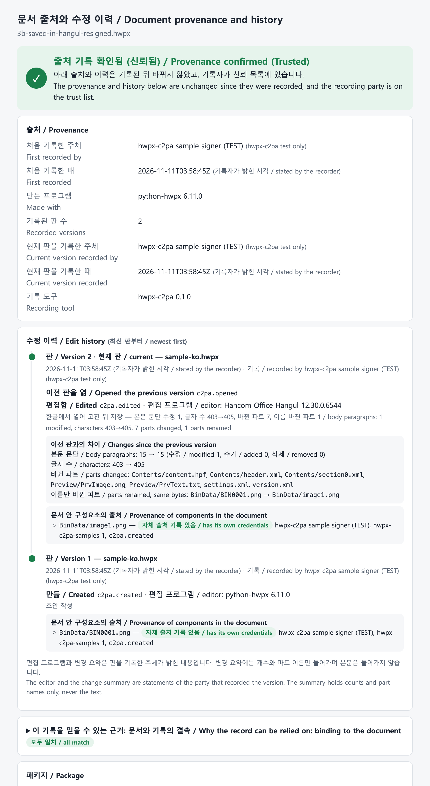

# hwpx-c2pa

**English** | [한국어](README.ko.md)

**Engine and Hangul add-ons that record and show the provenance and edit history of HWPX (OWPML, KS X 6101) documents as C2PA Content Credentials**

Author: Dongsun Nam (speeno) · License: MIT · Status: alpha (0.1.0)



- How it works, with block diagrams: [docs/how-it-works.md](docs/how-it-works.md)
- Worked example with screens: [docs/case-study.md](docs/case-study.md)
- Korean and English samples: [samples/](samples/)
- Problems and improvements for C2PA support in Hangul: [docs/hangul-c2pa-support.md](docs/hangul-c2pa-support.md)

## What it does

C2PA is a **provenance** record, not a signing feature. It lets a document carry where it came from and who did what, with which program, at each version. The signature and the hashes are the means of showing that this record has not been altered.

What this tool records for each version:

- **Who and when**: the recording party (certificate) and the time (time-stamp, else the time stated by the recorder).
- **With what**: the program that made or edited the document (name and version from `version.xml` in the package).
- **What was done**: created (`c2pa.created`), or previous version opened and edited (`c2pa.opened`, `c2pa.edited`), plus a note from the recorder (`--note`).
- **What changed**: a summary against the previous version (body paragraphs modified, added, removed; character count; parts changed). Counts and part names only, never the text.
- **Which version it derives from**: the record of the previous version is chained as `parentOf`, so the last file alone shows the whole history.
- **Where the pictures inside come from**: a picture that carries its own C2PA record (camera, drawing tool, generative AI and so on) is linked as `componentOf`.

For checking, `history` and `view` show this history version by version and, if the document changed after it was recorded, which part differs.

Technical basis: Annex A.6 (ZIP-based formats) of the C2PA Technical Specification 2.5. The record is one added part, `META-INF/content_credential.c2pa`; the OWPML schema is not changed. The record is built and signed by the official C2PA SDK (c2pa-rs through c2pa-python), and the hashes are recomputed independently for cross-checking (`check`). Hangul removes the part on save, so the add-ons record a new version after each save. See [docs/how-it-works.md](docs/how-it-works.md) for the structure.

## Install

```bash
pip install git+https://github.com/speeno/hwpx-c2pa
hwpx-c2pa fetch-lib     # fetch a C2PA library (0.91.11) that can process HWPX
hwpx-c2pa info          # expect "supported: True"
```

Why `fetch-lib`: the library bundled with c2pa-python 0.38.2 (0.91.6) cannot process Deflate-compressed ZIP entries, and every HWPX file uses Deflate. `fetch-lib` downloads the library from the official c2pa-rs release, checks its SHA-256, and stores it in the user cache.

## Use

```bash
# test certificates (never use them for real documents)
pip install "hwpx-c2pa[devcerts] @ git+https://github.com/speeno/hwpx-c2pa"
hwpx-c2pa dev-certs ./certs

# record the first version (sign and record are the same command)
hwpx-c2pa sign report.hwpx --note "First draft" --cert certs/signer-chain.pem --key certs/signer.key
# record an edited version: chains to the previous one and stores a change summary
hwpx-c2pa sign v2.hwpx --parent v1.hwpx --note "Budget in clause 3 revised" ...
hwpx-c2pa history v2.hwpx                  # origin and edit history per version
hwpx-c2pa view v2.hwpx --trust certs/root-ca.pem     # provenance and history window (browser)
hwpx-c2pa verify v2.hwpx --trust certs/root-ca.pem   # summary and exit code
hwpx-c2pa check v2.hwpx                    # recompute the hashes without the SDK
hwpx-c2pa watch ~/Documents/Signed         # watch a folder, record a new version after each save
```

- `verify` exit codes: 0 intact, 1 invalid (tampered), 2 no credentials, 3 error.
- States: `Trusted` (record intact, recording party on a trust list), `Valid` (record intact, recording party not on a trust list), `Invalid` (the document changed after the record, or the record is damaged).
- The editor name and the change summary are statements of the recording party, not of Hangul itself ([docs/how-it-works.md](docs/how-it-works.md), clause 5).
- To avoid passing the certificate and key each time, use the config file (`hwpx-c2pa info` prints its location):

```json
{"cert": "/path/signer-chain.pem", "key": "/path/signer.key", "tsa": "http://timestamp.example", "trust": "/path/anchors.pem"}
```

From Python:

```python
from hwpx_c2pa import load_signer, sign, verify
signer = load_signer("signer-chain.pem", "signer.key")
v1 = sign(open("report.hwpx", "rb").read(), signer, title="report.hwpx", note="First draft")
v2 = sign(open("edited.hwpx", "rb").read(), signer, title="report.hwpx", parent=v1, note="Budget revised")
for step in verify(v2).history:      # newest first
    print(step["version"], step["time"], step["recorded_by"], step["actions"], step["changes"])
```

## Hangul add-ons

| Add-on | Platform | What it does | Test status |
|---|---|---|---|
| `hwpx-c2pa watch`, `addon/macos/install-watch.sh` | macOS, Windows, Linux | Watches a folder and records each saved `.hwpx` as a new version (previous version chained, change summary). Needs no Hangul API | Tested, including files saved by Hangul 12.30 for Mac |
| `addon/windows/automation/hwpx_c2pa_hangul.py` | Windows, Hangul 2020+ | Attaches to the running Hangul, shows the provenance on open, records a new version right after save (HWP Automation events) | **Not tested** |
| `addon/windows/useraction/` (C++ DLL) | Windows | Hangul add-in (User Action Module) with "Save & Record" and "Show provenance" buttons | Builds in CI. **Not tested in Hangul** |

- Hangul for Mac has no add-in or automation interface, so the folder watcher is the only route there.
- Hancom allows HWP Automation free of charge for personal, non-commercial use only; commercial use needs Hancom's approval. The MIT licence of this repository covers this repository's code only.
- The Windows add-ons were written on a Mac from Hancom's public documents (HWP Automation manual, Addon Action guide). Test reports from Windows users are welcome.

## Known limits

- Real trust needs a certificate from a CA on the C2PA trust list or from an organisational PKI. Test certificates reach `Valid` only.
- Rewriting the ZIP (recompressing, saving with another program) breaks the match with the record even if the content is the same. The specification defines it so.
- A save that was not recorded leaves no trace in the history. The change summary is the difference between two recorded versions.
- The time is vouched for by a third party only when a time-stamp authority (`--tsa`) is used; otherwise it is shown as stated by the recorder.
- The C2PA SDK does not know `.hwpx` or `application/hwp+zip`; this tool passes packages as generic ZIP. To inspect a file with c2patool, rename it to `.zip`.
- SDK 0.90.x (c2patool 0.27.23) cannot read files signed by 0.91.
- Each version carries the earlier manifests, so files grow with the history.
- ZIP64 and encrypted (distribution) documents are not handled.

What Hangul itself would need in order to support C2PA is described in [docs/hangul-c2pa-support.md](docs/hangul-c2pa-support.md).

## Development

```bash
pip install -e ".[dev]" && hwpx-c2pa fetch-lib && pytest -q
```

The tests build a synthetic OWPML-shaped package; no Hancom software or sample documents are needed.

## References

- C2PA Technical Specification 2.5, Annex A.6: https://spec.c2pa.org/specifications/specifications/2.5/specs/C2PA_Specification.html
- c2pa-rs: https://github.com/contentauth/c2pa-rs · c2pa-python: https://github.com/contentauth/c2pa-python
- KS X 6101:2024 (OWPML)
- Hancom HWP Automation: https://developer.hancom.com/hwpautomation · manuals: https://github.com/hancom-io/devcenter-archive

"한글", "한컴오피스", "HWP", "HWPX" are names or trademarks of Hancom Inc. This project is independent of Hancom and of the C2PA.
