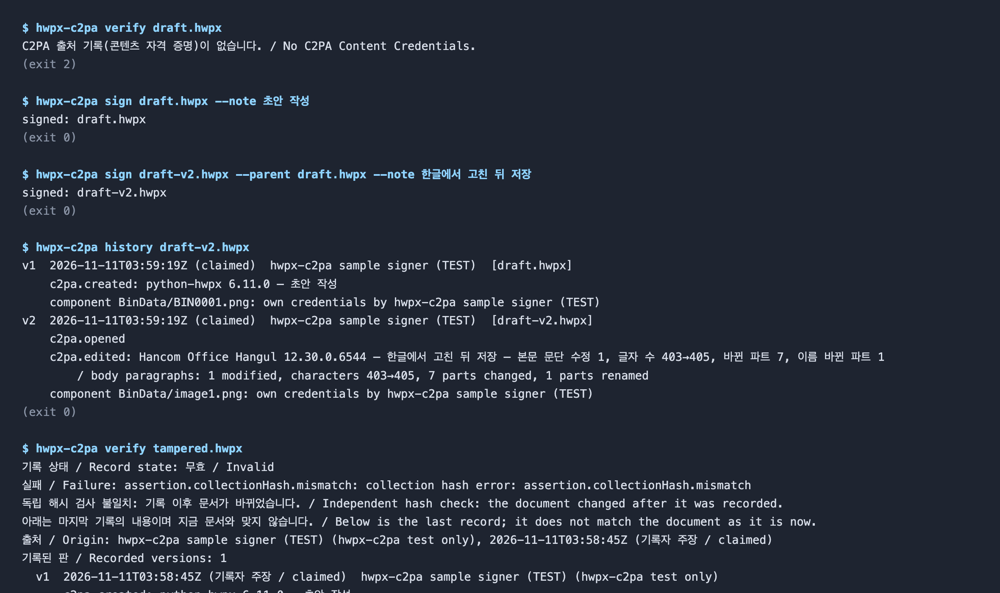
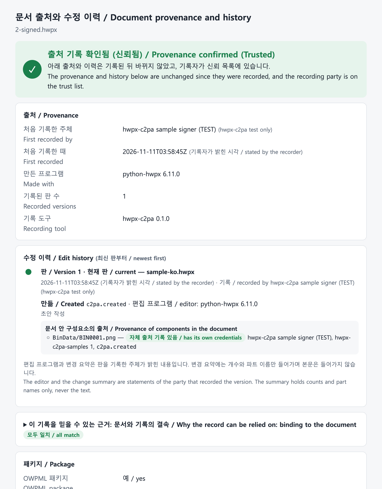
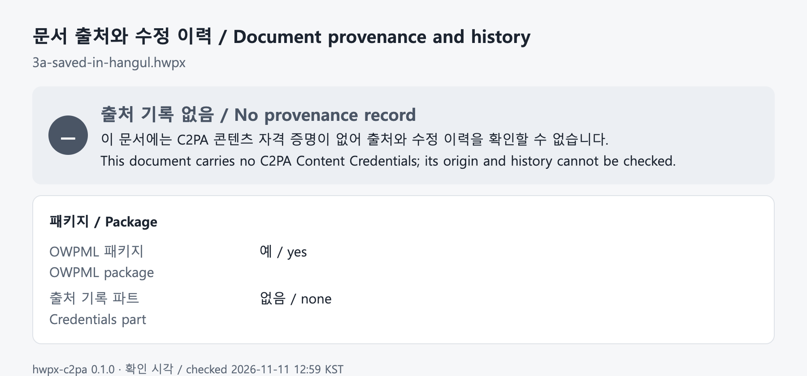
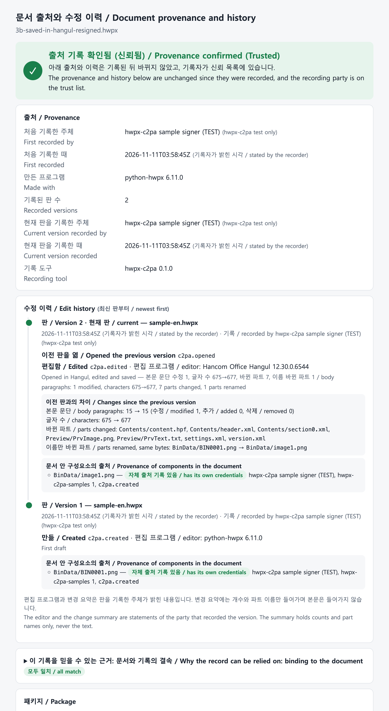
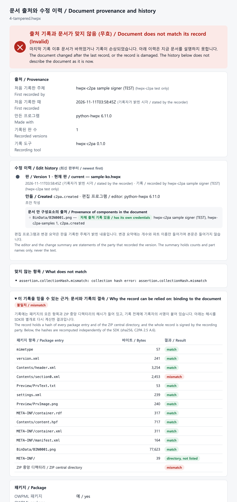
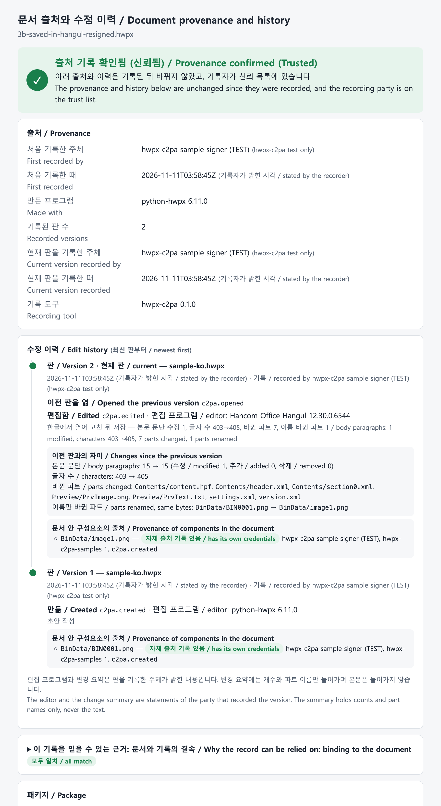
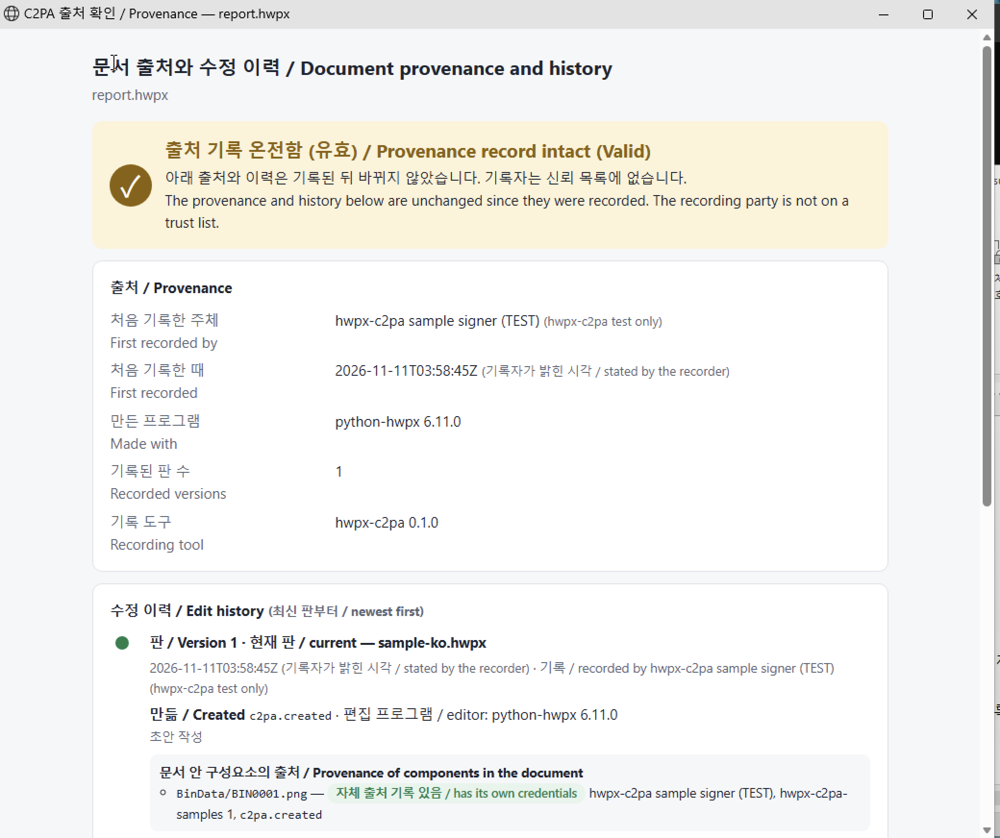
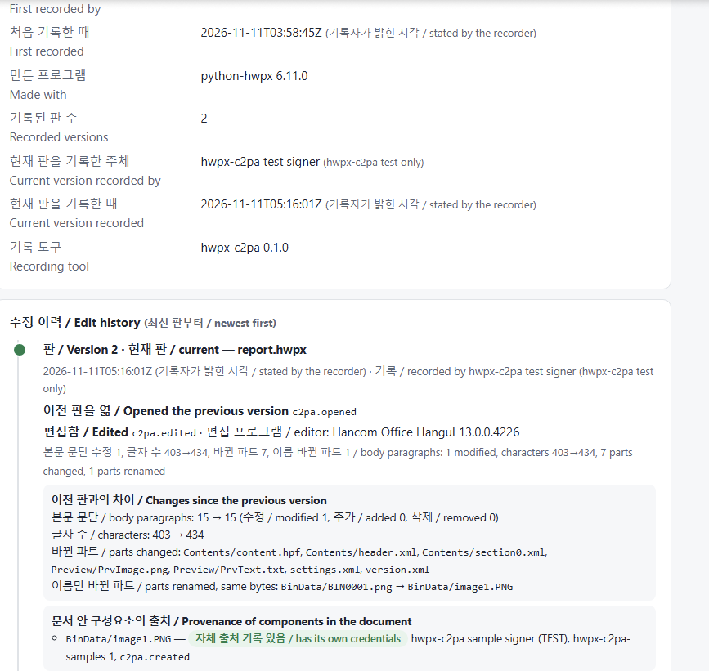
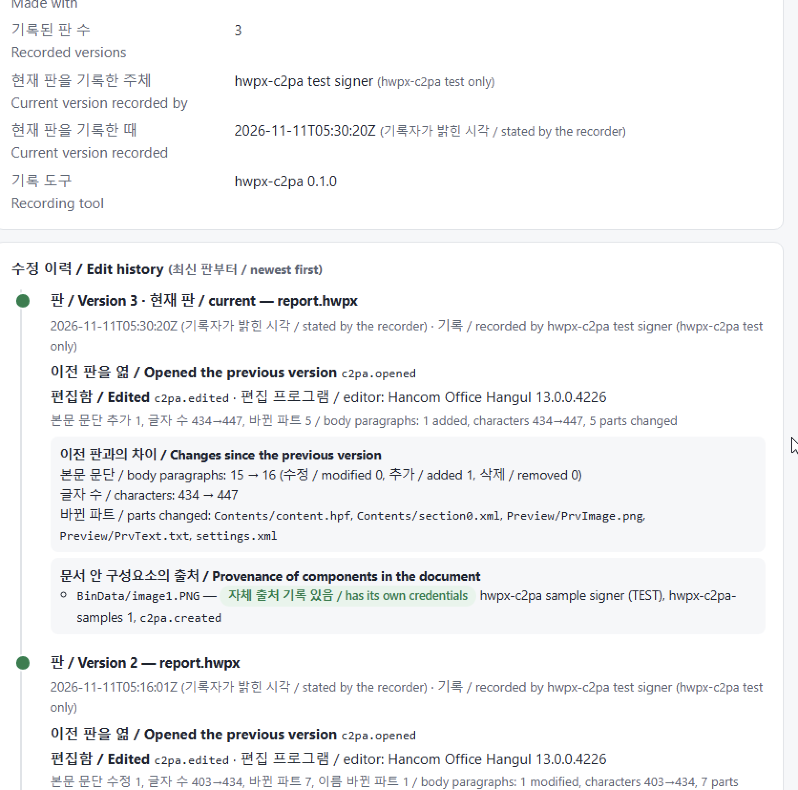
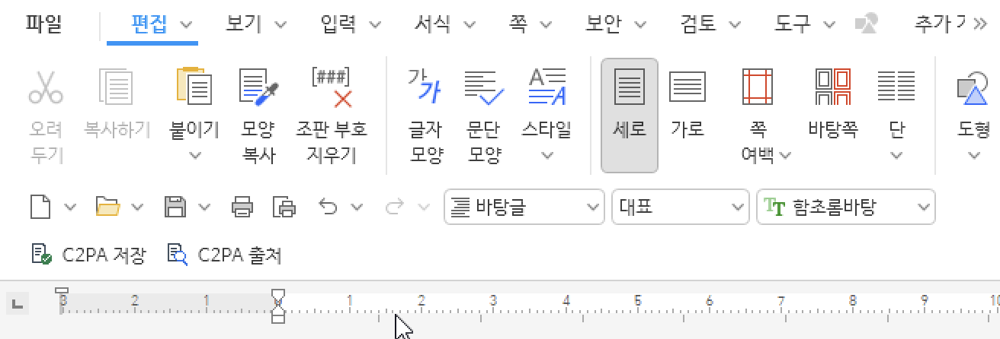

# C2PA applied to HWPX documents: provenance and edit history

**English** | [한국어](case-study.ko.md)

This example shows an HWPX document carrying where it came from and who did what, with which tool, at each version, as a C2PA record. The structure is explained with block diagrams in [how-it-works.md](how-it-works.md).

Every screen and result below was produced with the samples in `samples/` and the tools in this repository. The certificates used for recording are test certificates.

Environment: macOS with Hancom Office HWP 12.30.0 (6544), and Windows 11 with Hangul 2024 (13.0.0.4226); hwpx-c2pa 0.1.0, C2PA library 0.91.11.

## 1. Samples

The Korean (`samples/ko`) and English (`samples/en`) sets have the same structure.

| File | Content | Result |
|---|---|---|
| `1-unsigned.hwpx` | Sample document; only the picture has its own record | No record |
| `2-signed.hwpx` | Version 1 recorded: created (`c2pa.created`), authoring tool, note, provenance of the picture | Trusted, 1 version |
| `3a-saved-in-hangul.hwpx` | File 2 opened, edited and saved in Hangul | No record (removed by Hangul) |
| `3b-saved-in-hangul-resigned.hwpx` | 3a recorded as version 2: chained to file 2, editor Hangul 12.30, change summary | Trusted, 2 versions |
| `4-tampered.hwpx` | File 2 with the amount changed without a record | Invalid: does not match the record |

With `samples/test-root-ca.pem` as trust anchor the result is `Trusted`; without it, `Valid`.

## 2. Recording and reading the history (command line)



- Before recording: no record (exit code 2).
- `sign --note`: records version 1.
- `sign --parent`: records the file edited and saved in Hangul as version 2, chained to the previous version, with a change summary.
- `history`: version 1 created with python-hwpx; version 2 edited with Hangul 12.30, one body paragraph modified, 403→405 characters, 7 parts changed, the picture part only renamed. The picture carries its own record in both versions.
- A file changed without a record: Invalid (exit code 1).

This image is rendered from the actual command output (it is not a photograph of a terminal window).

## 3. Provenance and history window

`hwpx-c2pa view file.hwpx` opens the result in a browser window. The page shows, in this order, the origin, the edit history per version, the provenance of components, and why the record can be relied on (hash comparison). The captures below are of that page; its labels are in Korean and English.

### 3.1 Version 1

Who made the document, when, with what, and where the picture inside comes from.



### 3.2 After saving in Hangul

Hangul rewrites the package on save and drops the record part. In this state the origin cannot be checked.



### 3.3 Version 2 recorded: edit history

`hwpx-c2pa sign … --parent 2-signed.hwpx` or the folder watcher (`watch`) records the saved file as version 2. The window lists version 2 (previous version opened, edited with Hangul 12.30, changes since the previous version) and version 1 (created).



### 3.4 A document changed without a record

Changing the amount in the body makes the document differ from its last record. The window says that the history no longer describes the document and marks the part that differs (`Contents/section0.xml`).



### 3.5 Korean sample



## 4. Behaviour in Hangul

### Hangul 12.30 for macOS, no add-in

Checked with Hancom Office HWP 12.30 (macOS).

| Step | Result |
|---|---|
| Open the recorded file | Opens without warning; the file is unchanged |
| Save | The whole package is rewritten; `META-INF/content_credential.c2pa` is gone; the picture part is renamed (`BIN0001.png` → `image1.png`) |
| The picture's own record | Kept, because the bytes are unchanged |
| Recording the new version | Chained to the previous version and the picture, with editor and change summary; `Trusted` |

### Hangul 2024 for Windows, with the add-in

Checked with Hangul 2024 (13.0.0.4226, 32-bit) on Windows 11, started with `hwpx-c2pa hangul`. The document is `samples/ko/2-signed.hwpx`, copied as `report.hwpx`.

| Step | Result |
|---|---|
| Button "C2PA 출처" on the recorded sample | The provenance window opens: 1 version, created with python-hwpx |
| Type text, Ctrl+S | Version 2 is recorded in the open document: editor Hancom Office Hangul 13.0.0.4226, 1 paragraph modified, 403→434 characters |
| Type again, ordinary Save button | Version 3: 1 paragraph added, 434→447 characters, chained to version 2 |
| Hangul's own save, without the add-in | The record is removed, as on macOS |







What the tests showed about Hangul 2024:

- The User Action module mechanism of the 2008 guide is still present, but a module is loaded only when an automation client calls `RegisterModule("UserActionDLL", name)`; the call returns False even when the module loads.
- The strings of the module interface are ANSI. Hangul also calls `DoAction` with two GUID strings when the module is loaded; the toolbar is set up there.
- The file of an open document is locked for writing. `SaveAs(path, "HWPX", "lock:false")` on the same path does not release it; saving to another path with `lock:false` does, and leaves the document bound to its own path.
- `ReplaceAction` redirects Save for the IDs `FileSave` and `FileSave_S`.

The two buttons the add-in puts in the Hangul window:



## 5. Reproducing

```bash
pip install -e ".[dev]" python-hwpx && hwpx-c2pa fetch-lib
python samples/make_samples.py                      # files 1, 2, 4 (and 3b if 3a exists)
# open 2-signed.hwpx in Hangul, edit, save → 3a
hwpx-c2pa sign 3a.hwpx -o 3b.hwpx --parent 2-signed.hwpx --note "…" --cert … --key …
hwpx-c2pa history samples/en/3b-saved-in-hangul-resigned.hwpx
hwpx-c2pa view samples/en/2-signed.hwpx --trust samples/test-root-ca.pem
```

Running `make_samples.py` again records with new test certificates, so `test-root-ca.pem` changes too.

The sample documents start from the blank document of python-hwpx (Apache-2.0). The picture is generated by the script.
