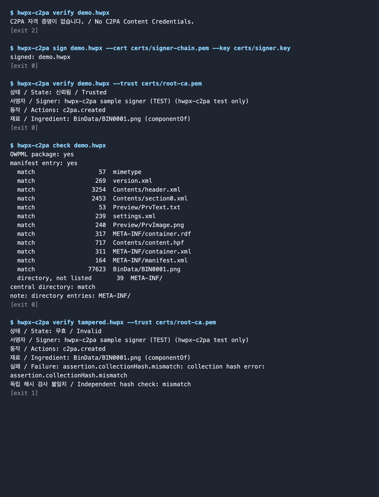
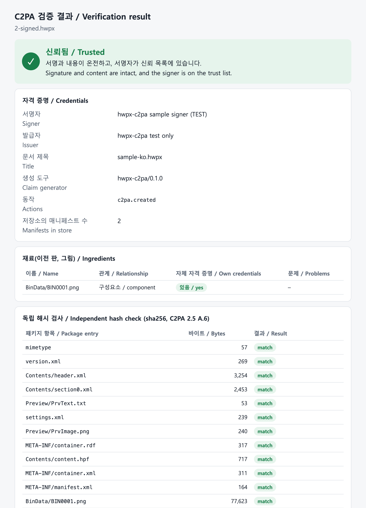
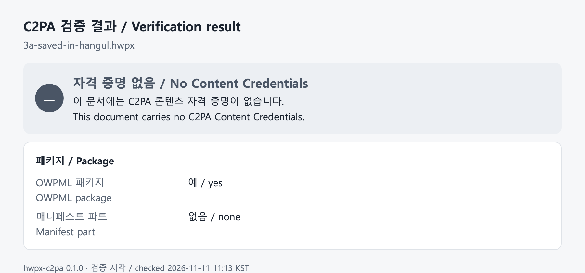
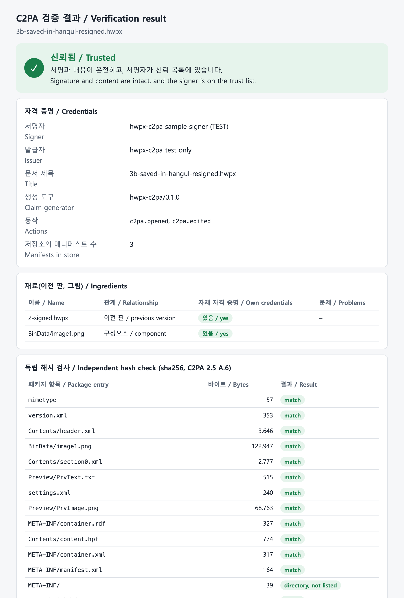
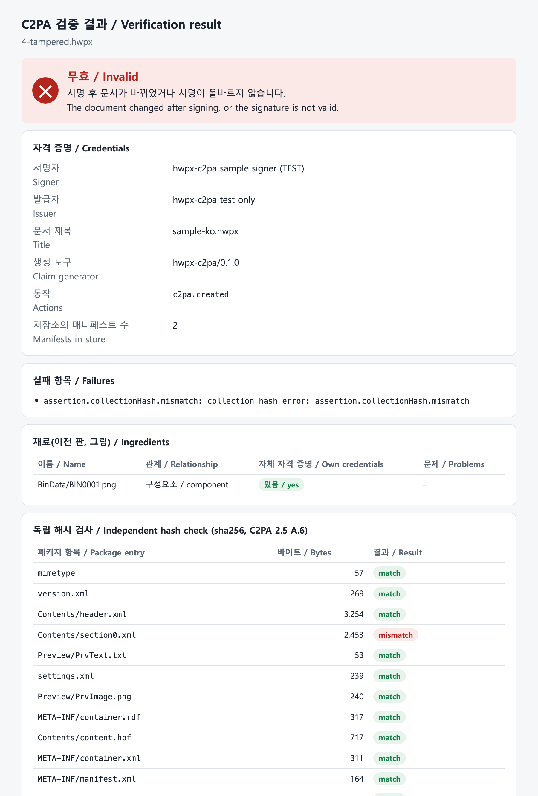

# HWPX 문서의 C2PA 적용 사례 / C2PA applied to HWPX documents: a worked example

모든 화면과 결과는 `samples/`의 샘플과 이 저장소의 도구로 만든 것이다. 서명 인증서는 시험용이다.
Every screen and result below was produced with the samples in `samples/` and the tools in this repository. The signing certificates are test certificates.

환경 / Environment: macOS, Hancom Office HWP 12.30.0 (6544), hwpx-c2pa 0.1.0, c2pa-python 0.38.2 + C2PA library 0.91.11.

## 1. 샘플 / Samples

한국어(`samples/ko`)와 영어(`samples/en`) 문서가 같은 구성으로 있다. / The Korean and English sets have the same structure.

| 파일 / File | 내용 / Content | 검증 결과 / Result |
|---|---|---|
| `1-unsigned.hwpx` | 샘플 문서. 그림만 자체 자격 증명을 가진다 / sample document; only the picture has credentials | 자격 증명 없음 / no credentials |
| `2-signed.hwpx` | 서명본 / signed | 신뢰됨 / Trusted |
| `3a-saved-in-hangul.hwpx` | 2번을 한글에서 열어 저장한 파일 / file 2 opened and saved in Hangul | 자격 증명 없음 / no credentials |
| `3b-saved-in-hangul-resigned.hwpx` | 3a를 2번을 이전 판으로 이어 다시 서명 / 3a signed again, chained to file 2 | 신뢰됨 / Trusted |
| `4-tampered.hwpx` | 2번의 금액을 서명 후 고친 파일 / file 2 with the amount changed after signing | 무효 / Invalid |

`samples/test-root-ca.pem`을 신뢰 기준으로 주면 `Trusted`가 나오고, 주지 않으면 `Valid`가 나온다.
With `samples/test-root-ca.pem` as trust anchor the result is `Trusted`; without it, `Valid`.

## 2. 생성과 검증 (명령줄) / Signing and validating (command line)



- 서명 전: 자격 증명 없음(종료 코드 2). / Before signing: no credentials (exit code 2).
- `sign` 후: 신뢰됨. 그림이 구성요소로 연결된다. / After `sign`: Trusted, with the picture linked as a component.
- `check`: SDK와 별개로 다시 계산한 해시가 모든 항목에서 일치한다. / the hashes recomputed without the SDK match for every entry.
- 변조본: 무효(종료 코드 1). / Tampered copy: Invalid (exit code 1).

이 그림은 실제 명령 출력을 그대로 옮겨 그린 것이다(터미널 창을 찍은 것이 아니다).
This image is rendered from the actual command output (it is not a photograph of a terminal window).

## 3. 검증 창 / Verification window

`hwpx-c2pa view 문서.hwpx`는 결과를 브라우저 창으로 연다. 아래는 그 창을 그대로 찍은 것이다.
`hwpx-c2pa view file.hwpx` opens the result in a browser window. The captures below are of that page.

### 3.1 서명본 / Signed document



### 3.2 한글에서 저장한 뒤 / After saving in Hangul

한글은 저장할 때 패키지를 새로 쓰고 자격 증명 파트를 버린다.
Hangul rewrites the package on save and drops the credentials part.



### 3.3 다시 서명: 판 이력 / Signed again: version chain

`hwpx-c2pa sign 3b….hwpx --parent 2-signed.hwpx` 또는 폴더 감시(`watch`)가 이전 판을 이어 서명한다. 동작은 `c2pa.opened`, `c2pa.edited`이고, 재료에 이전 판과 그림이 있다.
`sign --parent` or the folder watcher signs again and chains to the previous version. The actions are `c2pa.opened` and `c2pa.edited`; the ingredients are the previous version and the picture.



### 3.4 변조 / Tampering

본문의 금액을 고치면 본문 파트(`Contents/section0.xml`)가 불일치로 나온다.
Changing the amount in the body makes the body part (`Contents/section0.xml`) a mismatch.



### 3.5 영어 샘플 / English sample


## 4. 한글에서의 동작 / Behaviour in Hangul

Hancom Office HWP 12.30 (macOS)에서 확인했다. / Checked with Hancom Office HWP 12.30 (macOS).

| 단계 / Step | 결과 / Result |
|---|---|
| 서명본 열기 / open the signed file | 경고 없이 열린다. 파일은 바뀌지 않는다 / opens without warning; the file is unchanged |
| 저장 / save | 패키지 전체를 새로 쓴다. `META-INF/content_credential.c2pa`가 없어진다. 그림 파트 이름이 바뀐다(`BIN0001.png` → `image1.png`) / the whole package is rewritten; the credentials part is gone; the picture part is renamed |
| 그림의 자격 증명 / the picture's own credentials | 바이트가 그대로라 유지된다 / kept, because the bytes are unchanged |
| 다시 서명 / signing again | 이전 판과 그림을 이어 `Trusted` / `Trusted`, chained to the previous version and the picture |

### 아직 없는 화면 / Screens not yet included

- 한글 프로그램 창과 애드온 등록 화면은 이 판에 넣지 못했다. 작업 환경에 화면 기록 권한이 없었고, Mac용 한글에는 애드인 기능이 없다(등록 화면은 Windows판 "도구 > 추가 기능 설정"에 있다).
- The Hangul application window and the add-on registration screen are not in this edition. The working environment had no screen-recording permission, and Hangul for Mac has no add-in feature (the registration screen is "Tools > Add-in settings" in the Windows version).
- Windows 애드온(`addon/windows/`)은 아직 시험하지 못했다. Windows에서 확인한 화면과 결과를 환영한다. / The Windows add-ons are untested; screens and results from Windows are welcome.

## 5. 다시 만들기 / Reproducing

```bash
pip install -e ".[dev]" python-hwpx && hwpx-c2pa fetch-lib
python samples/make_samples.py                      # 1, 2, 4번 / files 1, 2, 4
# 2-signed.hwpx를 한글에서 열고 저장 → 3a / open 2-signed.hwpx in Hangul and save → 3a
hwpx-c2pa sign 3b.hwpx --parent 2-signed.hwpx --cert … --key …
hwpx-c2pa view samples/ko/2-signed.hwpx --trust samples/test-root-ca.pem
```

`make_samples.py`를 다시 돌리면 새 시험 인증서로 서명되므로 `test-root-ca.pem`도 바뀐다.
Running `make_samples.py` again signs with new test certificates, so `test-root-ca.pem` changes too.

샘플 문서의 틀은 python-hwpx(Apache-2.0)의 빈 문서에서 왔다. 그림은 스크립트가 생성한 것이다.
The sample documents start from the blank document of python-hwpx (Apache-2.0). The picture is generated by the script.
