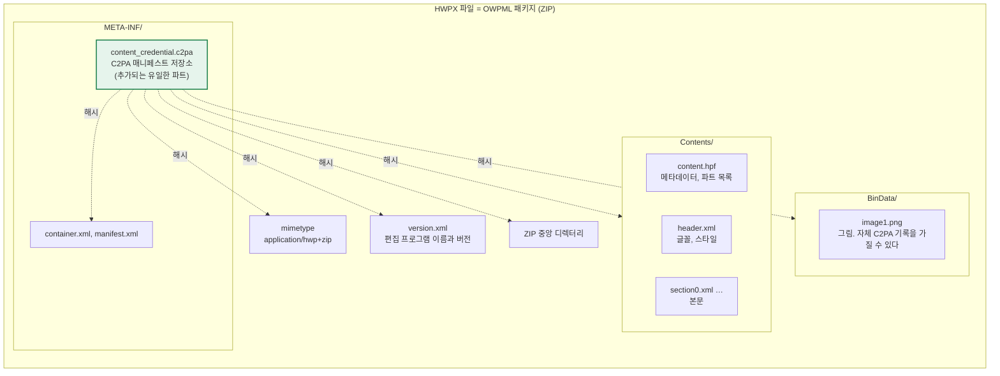
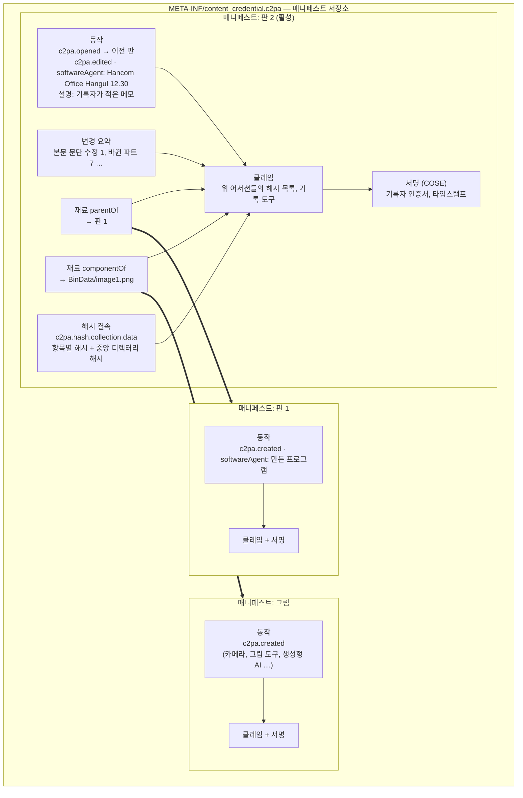
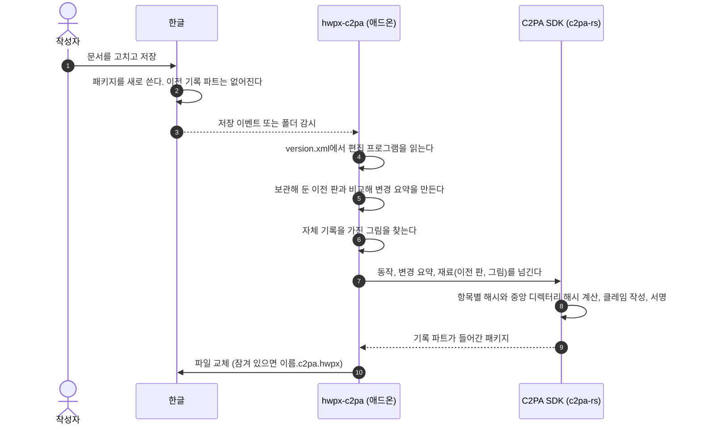
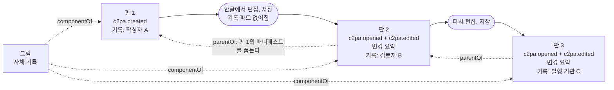
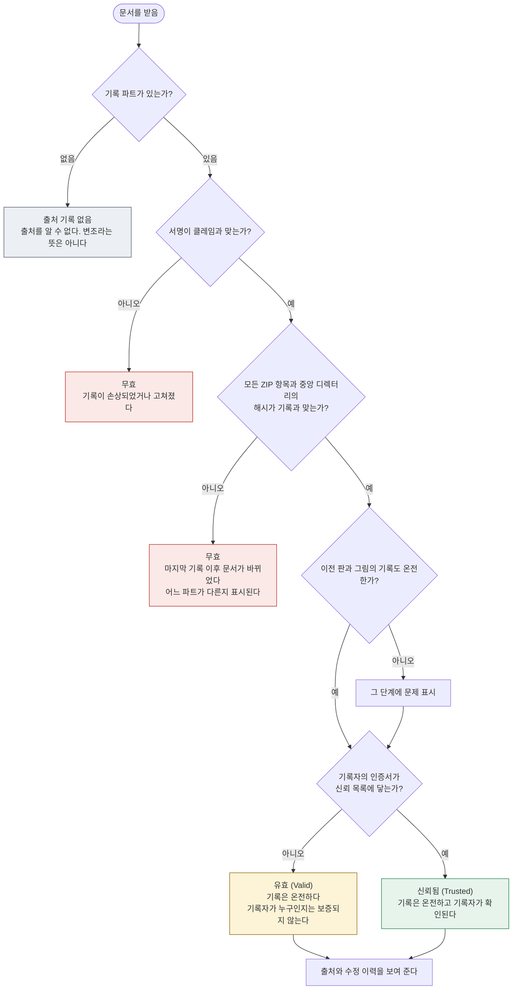
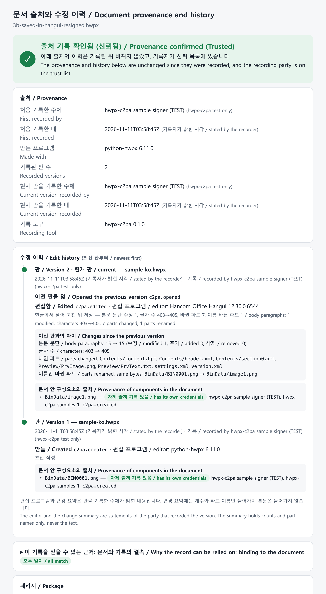

# 동작 원리: OWPML에 C2PA를 어떻게 넣고, 출처를 어떻게 증명하는가

[English](how-it-works.md) | **한국어**

C2PA의 목적은 전자서명 자체가 아니다. **문서가 어디서 왔고, 판마다 누가 무엇으로 무엇을 했는지**를 문서와 함께 들고 다니게 하는 것이다. 서명과 해시는 그 기록이 나중에 바뀌지 않았음을 보이는 수단이다.

| 질문 | C2PA 기록의 어느 부분이 답하는가 |
|---|---|
| 누가 기록했는가 | 서명 인증서의 주체 |
| 언제 | 타임스탬프(TSA), 없으면 기록자가 밝힌 시각 |
| 무엇으로 만들고 고쳤는가 | 동작의 `softwareAgent` |
| 무엇을 했는가 | 동작 목록 `c2pa.created`, `c2pa.opened`, `c2pa.edited` |
| 이전 판에서 무엇이 바뀌었는가 | 변경 요약 어서션 |
| 어느 판에서 나왔는가 | `parentOf` 재료 |
| 안에 든 그림은 어디서 왔는가 | `componentOf` 재료(그림 자체의 기록) |
| 이 기록이 지금 이 문서의 것인가 | 해시 결속과 서명 |

## 1. OWPML 패키지 안의 위치

HWPX 파일은 ZIP 패키지다. 출처 기록(매니페스트 저장소)은 파트 하나로 추가된다. 본문, 머리, 설정 같은 OWPML 파트와 스키마는 바뀌지 않는다.



- 근거: C2PA 기술 규격 2.5 부속서 A.6(ZIP 기반 형식). 파트 이름은 `META-INF/content_credential.c2pa`이고 압축하지 않고 넣는다.
- 해시는 파트의 "내용"이 아니라 ZIP 항목 전체(로컬 헤더, 압축된 데이터)에 건다. 그래서 내용이 같아도 ZIP을 다시 쓰면 기록과 맞지 않게 된다.

## 2. 기록 안에 무엇이 들어 있는가

저장소에는 판마다 매니페스트가 하나씩 들어간다. 가장 새 것이 "활성 매니페스트"이고, 이전 판과 그림의 매니페스트는 재료로 따라 들어온다.



- 클레임은 어서션들의 해시를 담고, 서명은 클레임에 붙는다. 그래서 동작 하나, 변경 요약 한 줄만 고쳐도 서명이 맞지 않는다.
- 이전 판의 매니페스트는 그 판을 기록한 주체의 서명을 그대로 가진 채 들어온다. 판마다 기록 주체가 달라도 된다(작성자, 검토자, 발행 기관).

## 3. 한 판을 기록하는 과정



한글은 C2PA를 모르기 때문에 4~10단계를 애드온이 대신한다. 따라서 "편집 프로그램"과 "변경 요약"은 한글이 직접 증언한 것이 아니라, 기록 주체가 패키지를 보고 밝힌 내용이다(5절).

## 4. 판이 이어지는 방식



- ZIP 형식에는 C2PA의 "갱신 매니페스트"를 쓸 수 없다. 그래서 판마다 새 매니페스트를 만들고 이전 판을 `parentOf` 재료로 잇는다.
- 판 3의 파일 하나만 있으면 판 1, 2, 3의 기록과 그림의 기록을 모두 볼 수 있다. 이전 판의 본문은 들어 있지 않다. 들어 있는 것은 기록뿐이다.
- 이전 판 없이 저장본만 기록하면 그 판은 새 출발점(`c2pa.created`)이 되고 이력이 끊긴다. 애드온이 저장 전 판을 보관하는 이유다.

## 5. 확인하는 과정과 알 수 있는 것



기록이 온전할 때 말할 수 있는 것과 없는 것:

| 구분 | 내용 | 믿는 근거 |
|---|---|---|
| 암호로 확인됨 | 기록 이후 문서의 어떤 바이트도 바뀌지 않았다. 기록 자체도 바뀌지 않았다. 이전 판과 그림의 기록이 그 판의 것이다 | 해시, 서명 |
| 인증서로 확인됨 | 기록 주체가 누구인가 | 신뢰 목록, 인증 기관 |
| 타임스탬프로 확인됨 | 기록 시각(TSA를 쓴 경우) | 타임스탬프 기관 |
| 기록 주체의 진술 | 편집 프로그램, 동작, 변경 요약, 메모, TSA 없는 시각 | 기록 주체에 대한 신뢰 |
| 알 수 없음 | 본문 내용이 사실인가. 기록되지 않은 중간 저장에서 무슨 일이 있었는가 | — |

"기록 주체의 진술" 줄이 중요하다. 지금은 한글이 아니라 애드온이 기록하므로, 편집 프로그램 이름은 `version.xml`에 적힌 값을 옮긴 것이다. 한글이 저장할 때 직접 기록하게 되면 이 줄의 항목이 "편집 프로그램이 증언함"으로 올라간다. [hangul-c2pa-support.ko.md](hangul-c2pa-support.ko.md)의 개선점이 겨냥하는 것이 이것이다.

## 6. 이 도구에서 보기

```bash
hwpx-c2pa history samples/ko/3b-saved-in-hangul-resigned.hwpx   # 판별 이력
hwpx-c2pa view    samples/ko/3b-saved-in-hangul-resigned.hwpx --trust samples/test-root-ca.pem
```


