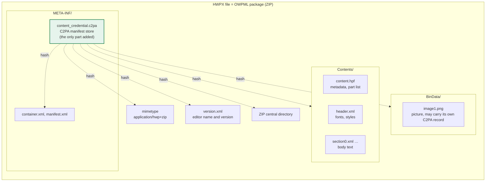
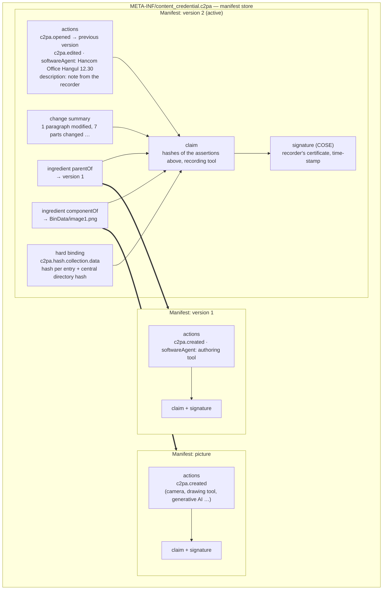
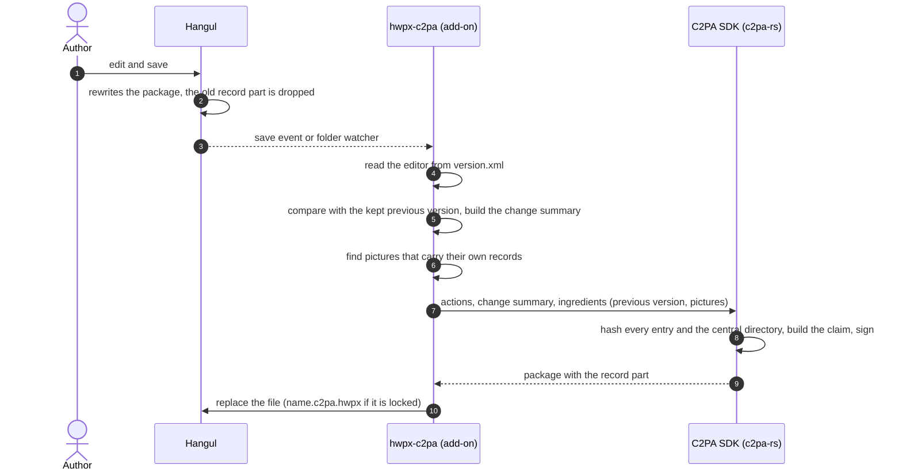
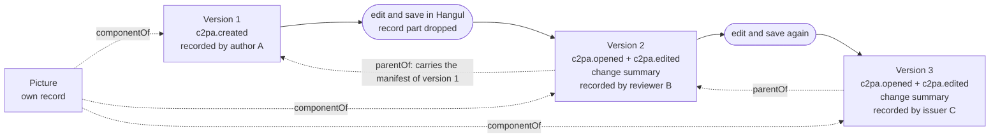
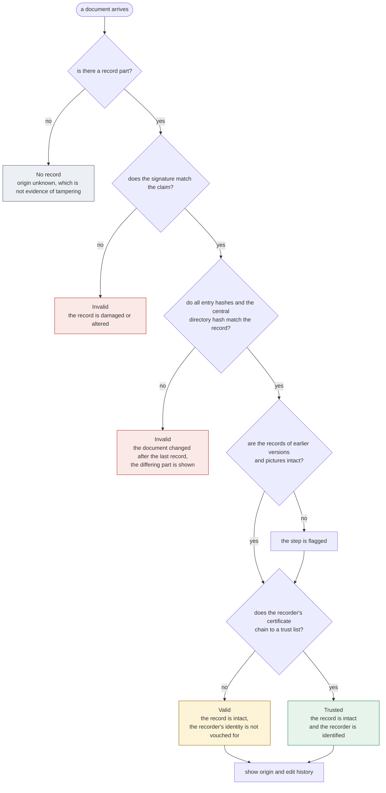

# How it works: C2PA in an OWPML package, and how provenance is shown

**English** | [한국어](how-it-works.ko.md)

C2PA is not a signing feature. Its purpose is that a document carries **where it came from and who did what, with which tool, at each version**. The signature and the hashes are only the means of showing that this record has not been altered.

| Question | Answered by |
|---|---|
| Who recorded it | Subject of the signing certificate |
| When | Time-stamp (TSA), else the time stated by the recorder |
| Made and edited with what | `softwareAgent` of each action |
| What was done | The actions `c2pa.created`, `c2pa.opened`, `c2pa.edited` |
| What changed since the previous version | Change summary assertion |
| Which version it derives from | `parentOf` ingredient |
| Where the pictures inside come from | `componentOf` ingredients (the pictures' own records) |
| Does the record belong to this document as it is now | Hash binding and signature |

## 1. Where it sits in the OWPML package

An HWPX file is a ZIP package. The provenance record (manifest store) is added as one part. The OWPML parts and schema are not changed.



- Basis: C2PA Technical Specification 2.5, Annex A.6 (ZIP-based formats). The part is `META-INF/content_credential.c2pa`, stored without compression.
- The hashes cover whole ZIP entries (local header and compressed data), not the decoded content. Rewriting the ZIP therefore breaks the match even if the content is the same.

## 2. What the record contains

The store holds one manifest per recorded version. The newest is the active manifest; the manifests of the previous version and of the pictures come along as ingredients.



- The claim holds the hashes of the assertions, and the signature covers the claim. Changing one action or one line of the change summary breaks the signature.
- The manifest of an earlier version keeps the signature of whoever recorded that version. Each version may be recorded by a different party (author, reviewer, issuing body).

## 3. Recording one version



Hangul does not know C2PA, so the add-on does steps 4 to 10 in its place. The editor name and the change summary are therefore statements made by the recording party from the package, not testimony of Hangul itself (see clause 5).

## 4. How versions are chained



- ZIP formats cannot take C2PA update manifests, so each version gets a new manifest with the previous version as its `parentOf` ingredient.
- The file of version 3 alone shows the records of versions 1, 2 and 3 and of the picture. It does not contain the text of earlier versions, only their records.
- If a saved file is recorded without its previous version, it becomes a new starting point (`c2pa.created`) and the history is cut. This is why the add-ons keep the version from before the save.

## 5. Checking, and what can be concluded



What an intact record does and does not establish:

| Kind | Content | Rests on |
|---|---|---|
| Cryptographically checked | No byte of the document or of the record changed since recording; the earlier records are the ones that were attached | Hashes, signature |
| Checked through certificates | Who recorded it | Trust list, CA |
| Checked through a time-stamp | Time of recording, if a TSA was used | Time-stamp authority |
| Statement of the recorder | Editor, actions, change summary, note, time without a TSA | Trust in the recorder |
| Not established | Whether the content is true; what happened in saves that were not recorded | — |

The row "statement of the recorder" matters. Today the add-on records, not Hangul, so the editor name is copied from `version.xml`. Once Hangul records at save time itself, these items become testimony of the editing program. That is what the improvements in [hangul-c2pa-support.md](hangul-c2pa-support.md) aim at.

## 6. Seeing it with this tool

```bash
hwpx-c2pa history samples/en/3b-saved-in-hangul-resigned.hwpx   # history per version
hwpx-c2pa view    samples/en/3b-saved-in-hangul-resigned.hwpx --trust samples/test-root-ca.pem
```


