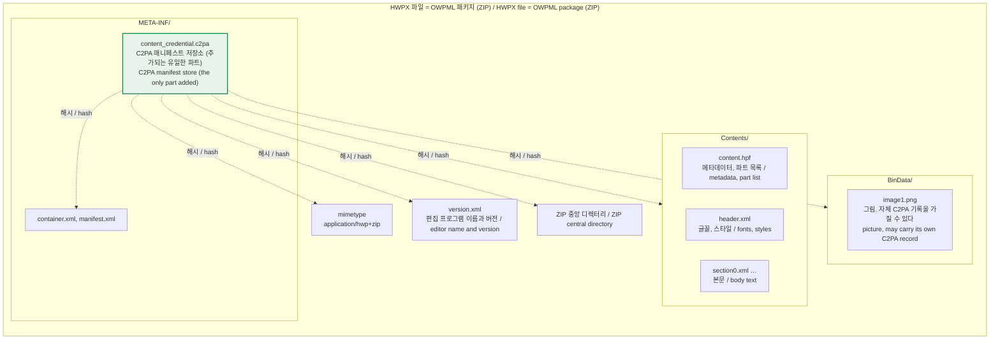
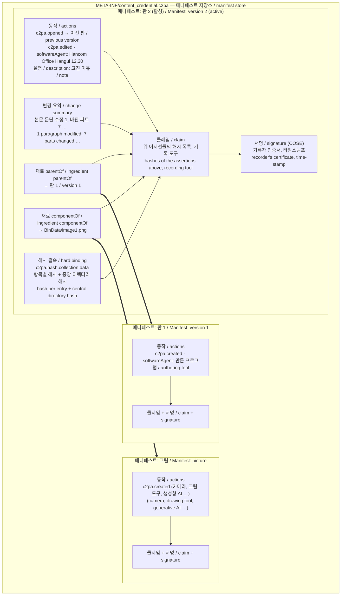
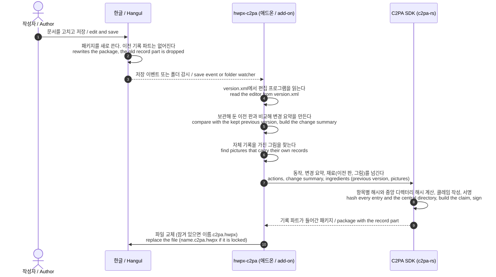
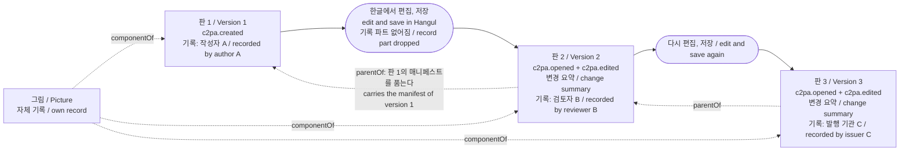
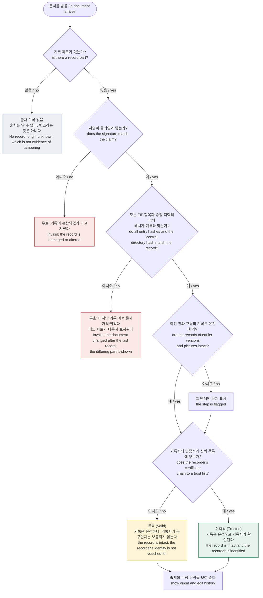
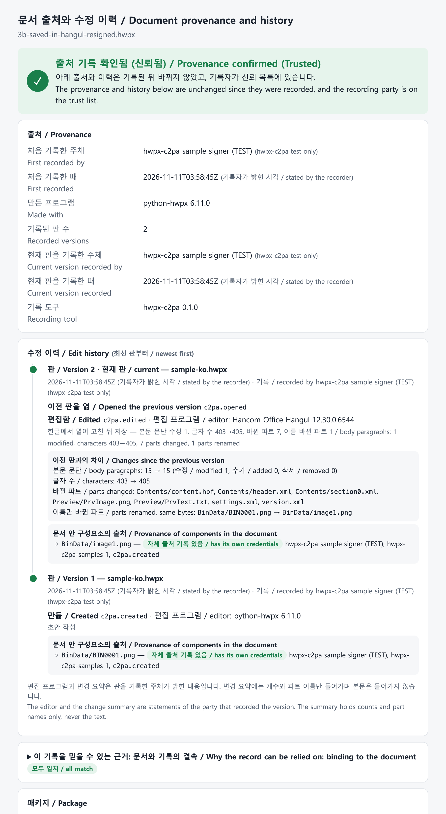

# 동작 원리: OWPML에 C2PA를 어떻게 넣고, 출처를 어떻게 증명하는가
# How it works: C2PA in an OWPML package, and how provenance is shown

C2PA의 목적은 전자서명 자체가 아니다. **문서가 어디서 왔고, 판마다 누가 무엇으로 무엇을 했는지**를 문서와 함께 들고 다니게 하는 것이다. 서명과 해시는 그 기록이 나중에 바뀌지 않았음을 보이는 수단이다.

C2PA is not a signing feature. Its purpose is that a document carries **where it came from and who did what, with which tool, at each version**. The signature and the hashes are only the means of showing that this record has not been altered.

| 질문 / Question | C2PA 기록의 어느 부분이 답하는가 / Answered by |
|---|---|
| 누가 기록했는가 / Who recorded it | 서명 인증서의 주체 / subject of the signing certificate |
| 언제 / When | 타임스탬프(TSA), 없으면 기록자가 밝힌 시각 / time-stamp, else the time stated by the recorder |
| 무엇으로 만들고 고쳤는가 / Made and edited with what | 동작의 `softwareAgent` / `softwareAgent` of each action |
| 무엇을 했는가 / What was done | 동작 목록 `c2pa.created`, `c2pa.opened`, `c2pa.edited` / the actions |
| 이전 판에서 무엇이 바뀌었는가 / What changed since the previous version | 변경 요약 어서션 / change summary assertion |
| 어느 판에서 나왔는가 / Which version it derives from | `parentOf` 재료 / `parentOf` ingredient |
| 안에 든 그림은 어디서 왔는가 / Where the pictures inside come from | `componentOf` 재료(그림 자체의 기록) / `componentOf` ingredients |
| 이 기록이 지금 이 문서의 것인가 / Does the record belong to this document as it is now | 해시 결속과 서명 / hash binding and signature |

## 1. OWPML 패키지 안의 위치 / Where it sits in the OWPML package

HWPX 파일은 ZIP 패키지다. 출처 기록(매니페스트 저장소)은 파트 하나로 추가된다. 본문, 머리, 설정 같은 OWPML 파트와 스키마는 바뀌지 않는다.

An HWPX file is a ZIP package. The provenance record (manifest store) is added as one part. The OWPML parts and schema are not changed.



- 근거: C2PA 기술 규격 2.5 부속서 A.6(ZIP 기반 형식). 파트 이름은 `META-INF/content_credential.c2pa`이고 압축하지 않고 넣는다.
- 해시는 파트의 "내용"이 아니라 ZIP 항목 전체(로컬 헤더, 압축된 데이터)에 건다. 그래서 내용이 같아도 ZIP을 다시 쓰면 기록과 맞지 않게 된다.
- Basis: C2PA Technical Specification 2.5, Annex A.6 (ZIP-based formats). The part is `META-INF/content_credential.c2pa`, stored without compression.
- The hashes cover whole ZIP entries (local header and compressed data), not the decoded content. Rewriting the ZIP therefore breaks the match even if the content is the same.

## 2. 기록 안에 무엇이 들어 있는가 / What the record contains

저장소에는 판마다 매니페스트가 하나씩 들어간다. 가장 새 것이 "활성 매니페스트"이고, 이전 판과 그림의 매니페스트는 재료로 따라 들어온다.

The store holds one manifest per recorded version. The newest is the active manifest; the manifests of the previous version and of the pictures come along as ingredients.



- 클레임은 어서션들의 해시를 담고, 서명은 클레임에 붙는다. 그래서 동작 하나, 변경 요약 한 줄만 고쳐도 서명이 맞지 않는다.
- 이전 판의 매니페스트는 그 판을 기록한 주체의 서명을 그대로 가진 채 들어온다. 판마다 기록 주체가 달라도 된다(작성자, 검토자, 발행 기관).
- The claim holds the hashes of the assertions, and the signature covers the claim. Changing one action or one line of the change summary breaks the signature.
- The manifest of an earlier version keeps the signature of whoever recorded that version. Each version may be recorded by a different party (author, reviewer, issuing body).

## 3. 한 판을 기록하는 과정 / Recording one version



한글은 C2PA를 모르기 때문에 5~10단계를 애드온이 대신한다. 따라서 "편집 프로그램"과 "변경 요약"은 한글이 직접 증언한 것이 아니라, 기록 주체가 패키지를 보고 밝힌 내용이다(5절).

Hangul does not know C2PA, so the add-on does steps 5 to 10 in its place. The editor name and the change summary are therefore statements made by the recording party from the package, not testimony of Hangul itself (see clause 5).

## 4. 판이 이어지는 방식 / How versions are chained



- ZIP 형식에는 C2PA의 "갱신 매니페스트"를 쓸 수 없다. 그래서 판마다 새 매니페스트를 만들고 이전 판을 `parentOf` 재료로 잇는다.
- 판 3의 파일 하나만 있으면 판 1, 2, 3의 기록과 그림의 기록을 모두 볼 수 있다. 이전 판의 본문은 들어 있지 않다. 들어 있는 것은 기록뿐이다.
- 이전 판 없이 저장본만 기록하면 그 판은 새 출발점(`c2pa.created`)이 되고 이력이 끊긴다. 애드온이 저장 전 판을 보관하는 이유다.
- ZIP formats cannot take C2PA update manifests, so each version gets a new manifest with the previous version as its `parentOf` ingredient.
- The file of version 3 alone shows the records of versions 1, 2 and 3 and of the picture. It does not contain the text of earlier versions, only their records.
- If a saved file is recorded without its previous version, it becomes a new starting point (`c2pa.created`) and the history is cut. This is why the add-ons keep the version from before the save.

## 5. 확인하는 과정과 알 수 있는 것 / Checking, and what can be concluded



기록이 온전할 때 말할 수 있는 것과 없는 것 / What an intact record does and does not establish:

| 구분 / Kind | 내용 / Content | 믿는 근거 / Rests on |
|---|---|---|
| 암호로 확인됨 / Cryptographically checked | 기록 이후 문서의 어떤 바이트도 바뀌지 않았다. 기록 자체도 바뀌지 않았다. 이전 판과 그림의 기록이 그 판의 것이다 / no byte of the document or of the record changed since recording; earlier records are the ones that were attached | 해시, 서명 / hashes, signature |
| 인증서로 확인됨 / Checked through certificates | 기록 주체가 누구인가 / who recorded it | 신뢰 목록, 인증 기관 / trust list, CA |
| 타임스탬프로 확인됨 / Checked through a time-stamp | 기록 시각(TSA를 쓴 경우) / time of recording, if a TSA was used | 타임스탬프 기관 / time-stamp authority |
| 기록 주체의 진술 / Statement of the recorder | 편집 프로그램, 동작, 변경 요약, 메모, TSA 없는 시각 / editor, actions, change summary, note, time without a TSA | 기록 주체에 대한 신뢰 / trust in the recorder |
| 알 수 없음 / Not established | 본문 내용이 사실인가. 기록되지 않은 중간 저장에서 무슨 일이 있었는가 / whether the content is true; what happened in saves that were not recorded | — |

- "기록 주체의 진술" 줄이 중요하다. 지금은 한글이 아니라 애드온이 기록하므로, 편집 프로그램 이름은 `version.xml`에 적힌 값을 옮긴 것이다. 한글이 저장할 때 직접 기록하게 되면 이 줄의 항목이 "편집 프로그램이 증언함"으로 올라간다. [hangul-c2pa-support.md](hangul-c2pa-support.md)의 개선점이 겨냥하는 것이 이것이다.
- The row "statement of the recorder" matters. Today the add-on records, not Hangul, so the editor name is copied from `version.xml`. Once Hangul records at save time itself, these items become testimony of the editing program. That is what the improvements in [hangul-c2pa-support.md](hangul-c2pa-support.md) aim at.

## 6. 이 도구에서 보기 / Seeing it with this tool

```bash
hwpx-c2pa history samples/ko/3b-saved-in-hangul-resigned.hwpx   # 판별 이력 / history per version
hwpx-c2pa view    samples/ko/3b-saved-in-hangul-resigned.hwpx --trust samples/test-root-ca.pem
```


